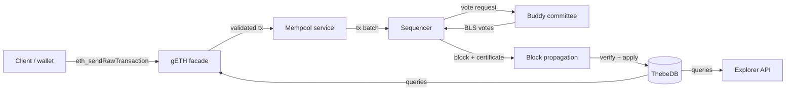

# JMDN Architecture

JMDN is the JMDT network's peer-to-peer node. It discovers peers over libp2p,
takes part in committee-based consensus (AVC), validates and applies blocks,
stores chain and account state in ThebeDB, and serves Ethereum-compatible and
node-management APIs.

For setup see [GETTING_STARTED.md](./GETTING_STARTED.md) and
[DOCKER.md](./DOCKER.md). For ports see [PORTS.md](./PORTS.md).

## Block lifecycle

1. Transactions arrive through the Ethereum JSON-RPC facade (`gETH/`) or the
   block API (`Block/`), pass the checks in `Security/`, and go to the external
   mempool service over gRPC.
2. The sequencer (`Sequencer/`) builds a block and asks a committee of buddy
   nodes (`AVC/`) to vote. Committee membership comes from signed seed-node
   snapshots (`seednode/`).
3. Each vote is a BLS signature bound to the block hash, chain id and height.
   A block certificate needs a `2f+1` quorum over the authenticated committee.
4. The block and its certificate are propagated (`messaging/`, `blockgossip/`).
   Receivers recompute the canonical block hash and transaction root
   (`consensushash/`), verify the certificate, enforce parent/height linkage,
   record equivocation, and apply the block to ThebeDB.
5. L1 rollup commitments are applied by `l1finality/`, with sender
   authentication in `internal/l1auth/`.

## Storage

ThebeDB is the only storage backend.

- **KV log (BadgerDB, embedded)**: the append-only canonical record of blocks,
  transactions and accounts. Path: `thebe.kv_path`.
- **SQL projection (PostgreSQL)**: queryable tables derived from the KV log,
  used by JSON-RPC and the explorer. DSN: `thebe.sql_dsn` / `THEBE_SQL_DSN`.
- **Redis**: account sync queue.

`DB_OPs/` holds the node's storage operations (accounts, blocks, receipts,
consensus lock ledger, sync anchor, equivocation store). `thebesync/` applies
blocks received during catch-up. `internal/syncmonitor/` periodically compares
local state with the seed node's view and triggers catch-up when the node falls
behind. `FastsyncV2/` holds the full-sync engine, currently disabled by default
(`fastsync.enabled: false`).

## Consensus details

- **Sequencer** (`Sequencer/`): proposes blocks and drives the consensus state
  machine. `internal/proposalguard/` admits at most one proposal per height.
- **Committee** (`AVC/BuddyNodes/`, `AVC/NodeSelection/`): VRF-based buddy
  selection, vote message passing and vote authorization. An operator
  `block_buddy` blocklist is subtracted from the eligible set.
- **Signing ledger** (`internal/roundlock/`): a buddy records what it signed at
  each height before releasing a vote, so it does not sign two different blocks
  at the same height, including across restarts.
- **BLS** (`AVC/BLS/`): vote signing and verification. Several vote-domain
  versions are accepted during a rollout, chosen by version precedence.
- **BFT engine** (`AVC/BFT/`): signed PREPARE/COMMIT exchange; `f = (n-1)/3`.
- Verification is fail-closed: with no committee source, a source error or an
  empty eligible set, the node rejects the certificate.

## Package map

| Area | Packages |
| --- | --- |
| Entry point | `main.go` — wires the libp2p host, ThebeDB, gRPC/HTTP servers, sync, metrics and consensus |
| Networking | `node/`, `Pubsub/`, `messaging/`, `blockgossip/` |
| Consensus | `Sequencer/`, `AVC/`, `consensus/`, `internal/roundlock/`, `internal/votecheck/`, `internal/proposalguard/`, `internal/sequencerid/` |
| Validation | `Security/`, `consensushash/` |
| State and sync | `DB_OPs/`, `thebesync/`, `FastsyncV2/`, `internal/syncmonitor/`, `l1finality/` |
| Execution | `SmartContract/`, `execbridge/` |
| APIs | `gETH/` (JSON-RPC 8545, WebSocket 8546, gRPC), `Block/` (HTTP + gRPC), `explorer/`, `CLI/`, `DID/`, `txstatus/` |
| Peer registry | `seednode/` (registration, committee snapshots, reputation push), `internal/reputation/` |
| Security plumbing | `pkg/gatekeeper/` (auth tokens, rate limits, TLS), `CA/` |
| Cross-cutting | `config/` (settings, protocol IDs, pubsub topics), `logging/`, `metrics/`, `shutdown/`, `profiler/`, `helper/` |

## Configuration

Settings load in this order, later wins: built-in defaults, `jmdn.yaml`
(`/etc/jmdn/` first, then the working directory), `JMDN_`-prefixed environment
variables, then command-line flags. `jmdn_default.yaml` is the shipped
template; the schema is in `config/settings/`.

Protocol IDs and pubsub topic names live in `config/constants.go`. Changing a
wire protocol or its version affects network compatibility.

## Observability

- Prometheus metrics on `ports.metrics` (disabled by default), with Grafana
  dashboards in `grafana/`.
- Structured logging via `logging/`, with console, file and OpenTelemetry
  outputs configured under `logging:` in `jmdn.yaml`.

## Further reading

- [CLI_COMMANDS.md](./CLI_COMMANDS.md) — operator commands
- [explorer/API_DOCUMENTATION.md](./explorer/API_DOCUMENTATION.md) — explorer REST API
- [SmartContract/README.md](./SmartContract/README.md) — EVM module
- [docs/audit/](./docs/audit/) — consensus and storage reviews and incident write-ups
