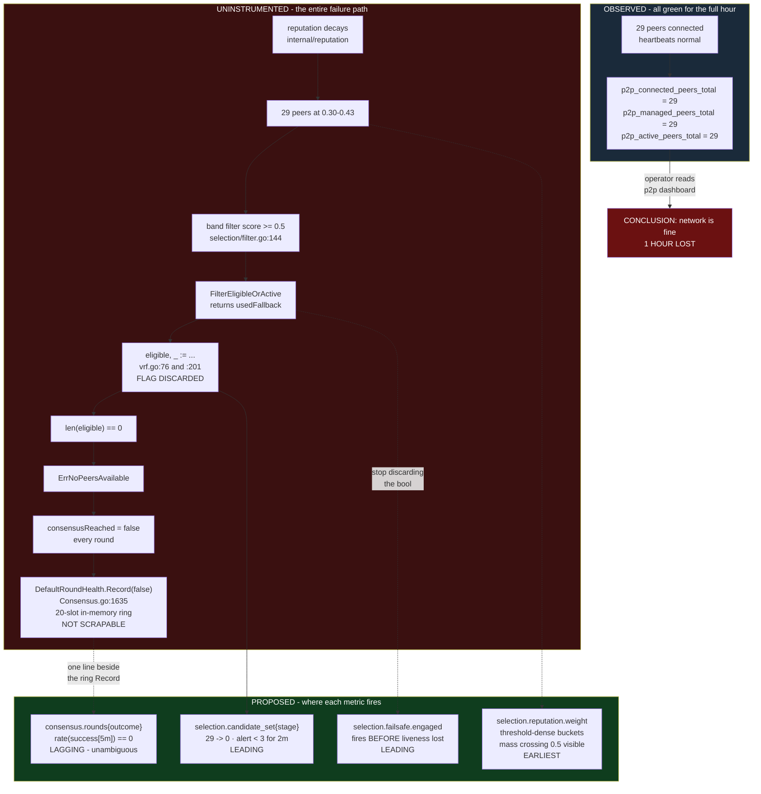
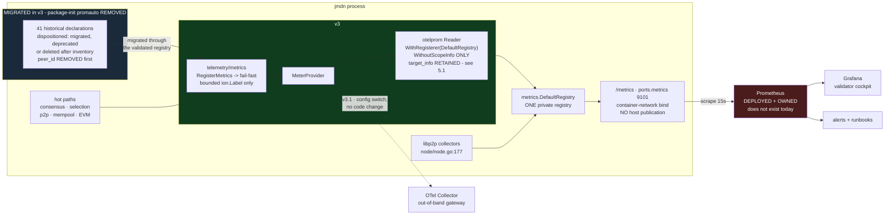
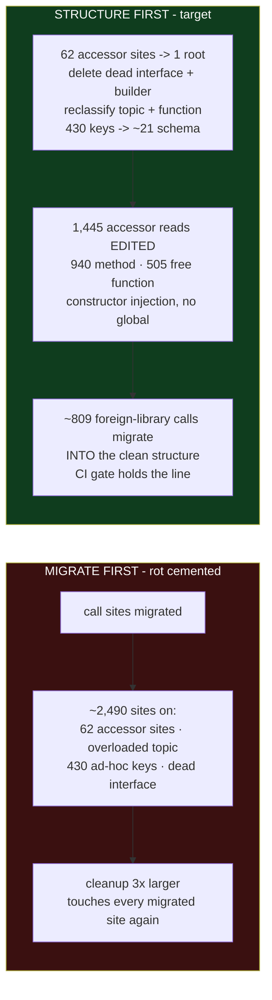
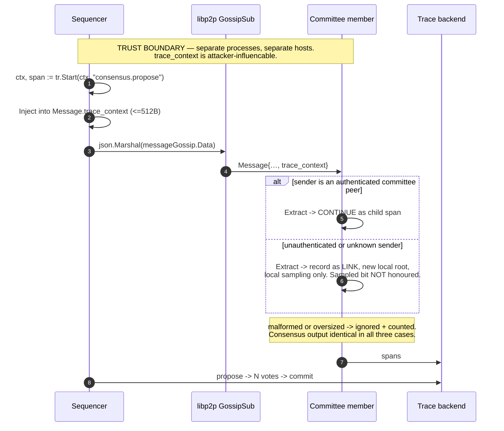

# JMDN v3 — Telemetry Architecture

**Status:** FROZEN at the five-round convergence baseline · **Date:** 2026-09-25
**Freeze condition outstanding:** a named production observability owner (§13). Production promotion
is blocked until that is satisfied; the technical architecture is not.
**Amendment rule:** if executable evidence falsifies a frozen assumption, amend the affected section
with the failing probe and its impact. Do not reopen settled decisions by preference.
**Target:** jmdn `v3base` (HEAD `efa4501`) · **Reference incident:** 2026-09-17 chain halt (>1h, undiagnosed)
**Operator goal for v3:** unify logging + metrics, pristine clean structure.
**Companion:** `DECISION-RECORD.md` — what was contested across four review rounds, how each item was settled, and what remains open.

All counts below were measured by `grep`/`git` over `v3base` at HEAD `efa4501` and carry their
`file:line`. **No code was executed** — no Go toolchain is available in this environment. Every code
proposal is `Untested: execution unavailable`; per-item validation commands are in §11.

---

## 1. Decision

**Keep ion as a thin facade over the OpenTelemetry SDK. Ship v0.6.0 additively. Unify jmdn's logging
and metrics behind one `telemetry/` package with a shared schema. Use one private Prometheus registry
and direct scrape. Defer cross-process tracing to v3.1.**

Order of work, and the sequencing is not negotiable:

1. **Halt detector first — a *promotion* gate, not a work-stop** (8–12 days + SRE). CI on `v3base`, `peer_id` labels removed, scrape path deployed and owned, three incident metrics through a fail-fast boundary, alerts with absence companions, the synthetic 29-peer recurrence test. This is the reason the programme exists; it completes and is verified before anything else starts.
2. **Then structure and unification** (47–66 days). One `internal/telemetry/` package with a `Runtime` constructed in `main`; one schema; **constructor injection replacing all 62 accessor sites — no global accessor survives**; the 41 legacy metrics migrated and package-init `promauto` removed; dead abstractions deleted; CI gates; then the call-site migration.

**v3 total: 59–85 engineer-days + 6–10 SRE days**, built as additive, non-overlapping workstreams:

| Workstream | Days | Contents |
|---|---:|---|
| **W1** Incident gate | 8–12 | CI on `v3base`, `peer_id` removal, scrape path, three halt metrics, alerts, 29-peer test |
| **W2** Telemetry kernel | 16–23 | `Runtime`, capability-separated injection for 940 method reads (A), the 505 free-function tail (A2), `schema` package (B) |
| **W3** Historical metric convergence | 6–9 | 41 declarations dispositioned, package-init `promauto` removed, halt adapter removed, `Gather()` golden (B2) |
| **W4** Logging structure and call sites | 21–29 | four high-volume keys (C), output manifest (D), stdlib `log` (F), zerolog (G), context bugs (H) |
| **W5** Enforcement | 4–5 | analyzer harness and the nine rules (E) |
| **W6** Clean-room release gate | 4–7 | temporary forwarder deleted, adapters deleted, `logging/` deleted, full-tree gate green |
| **Total** | **59–85** | + 6–10 SRE days |

**Sequencing — a promotion dependency, not a work-stop.** W1 must merge, ship and be *proven* before
anything promotes to production. That is a release gate, not a reason to idle engineers through SRE
deployment and soak. **Once W1's metric contract and descriptor golden are frozen**, the `gETH/` and
`FastsyncV2/` spikes and non-conflicting W2 runtime work proceed in parallel. An earlier "nothing else
starts" rule added elapsed time without protecting the gate. W2 still precedes W4 (structure before
volume, §6.1); W3 and W5 parallelise with W4; W6 is terminal by definition.

This supersedes three earlier figures in this document that did not reconcile (52–70 headline, 44–58
structure, 28–38 structure). Sol's independently built range is 55–82 + 6–10 SRE; the ~4-day gap is
in the kernel estimate and is inside the noise of both. Both replace ranges with measured throughput
after the `gETH/` and `FastsyncV2/` spikes and the 41-metric inventory.

Round-5 context: the output allowlist is
larger than a directory split suggested (§2.6), the four high-volume keys need semantic
classification rather than a scripted edit (§8.4), and the accessor refactor touches 62 sites across
58 files (§2.7), and again in round 8 for the capability-separated injection surface (§6.2a). The
honest pre-spike planning envelope across both reviews is **55–85 engineer-days**; that is a range,
not a negotiated midpoint, and both sides replace it with measured throughput after the spikes.

**Scope boundary — settled between both reviews.** v3 is **structural convergence**: one runtime,
constructor-injected logging and typed metrics, all 41 historical metrics dispositioned and every live
one migrated, no application `promauto` / old `logging/` / global accessor / temporary adapter at GA,
and the chain/consensus/selection/security/panic/telemetry-health signals. v3.1 is **coverage**: new
divergence, sync, mempool, richer p2p, RPC and EVM instruments. *Unification* is about how
measurements are owned and constructed; *coverage* is about how many exist. No operator arbitration
is needed unless the operator wants v3.1 coverage pulled into the v3 date.

Deferred to v3.1: cross-process propagation, the Collector + trace backend, ion v0.6.0
generalisation, and — under this document's reading — new domain metrics for sync, mempool, EVM and
RPC. **Legacy metric migration stays in v3**: it is what removes package-init `promauto`, so it is
structural.

---

## 2. Verified ground truth

Part 1 of the original brief was measured from source and is largely accurate. These are the
corrections and the material additions.

### 2.1 The fleet is six repos, but not the six that were assumed

`seedNodes` and `JMDN-Mempool` do not import ion at all — no `go.mod` require, zero `.go` references;
both use zap. Two deeper consumers were missing from the original inventory.

| Repo | ion pin | `.go` files | Coupling |
|---|---|---:|---|
| jmdn | `jmdn/go.mod:11` v0.5.0 | 135 | logger + tracer |
| Mempool-Routing-Engine | `Mempool-Routing-Engine/go.mod:7` v0.5.0 | 29 | logger + tracer + **meter** |
| JMDT-Sequencer-Orchestrator | `JMDT-Sequencer-Orchestrator/go.mod:6` v0.5.0 | 26 | logger + tracer + **span status** |
| JMDN-FastSync | `JMDN-FastSync/go.mod:8` v0.5.0 | 22 | `*ion.Ion` in exported struct fields |
| avc | `avc/go.mod:7` v0.5.0 | 7 | logger only |
| ThebeDB | `ThebeDB/go.mod:6` v0.5.0 | 4 | **`ion.Config` in on-disk YAML schema** |
| jmdt-simulator | v0.5.0 | 6 | the only `ion/fields` adopter |

### 2.2 ion's metrics and span-status APIs are already proven in the fleet

- **`Ion.Meter()` is in production.** Mempool-Routing-Engine calls it at `internal/v1/app/app.go:215,268,376,407,429` and injects `metric.Meter` into components. It is a **mixed** reference for error handling: `components/monitor/monitor.go:52` is `New(...) (*Monitor, error)` and fails fast; `components/hashlookup/resolver.go:96` is `NewResolver(deps) *Resolver` and warns-then-degrades on all seven instrument failures (`:111-139`). The latter produces exactly the silent-no-op outcome §5 bans.
- **`ion.StatusOK`/`StatusError`/`StatusUnset` exist** at `ion/tracer.go:20-27` and JMDT-Sequencer-Orchestrator uses them at `cmd/orchestrator/processor.go:568,570,585,597,606,629`.
- jmdn's **0** `SetStatus` calls against **296** `RecordError` calls are a local enforcement failure, not a missing capability. `ion.RecordError` delegates straight to the OTel span (`ion/tracer.go:141`) and does not set status, so 296 spans record an error and none is marked failed.
- **`ion/fields` is not unused** — 6 production files in `jmdt-simulator` import it. Schema-as-code sticks where adopted from day one and fails where retrofitted without a gate. That is the diagnosis; §10 supplies the gate.

### 2.3 CI does not run on `v3base`

`.github/workflows/ci.yml:3-7` triggers only on `main` and `release/**`. Every enforcement mechanism
in §10 is dormant until this changes. `sonarqube.yml:15` is separately disabled (`if: false`).

### 2.4 The fleet is on ion v0.4.2, and that is safe

`origin/main`, `origin/release/2.0.x` and `origin/release/1.2.x` pin **v0.4.2**;
`origin/release/1.1.x` pins **v0.3.5**. Only `v3base` and PR branches are on v0.5.0 — so CI is
currently running against v0.4.2.

`v0.4.2 → v0.5.0` changed **zero `.go` files**: one commit, `4811b98 chore: dependency refresh
(OTel 1.46, grpc 1.83.2) + Go 1.26 floor`, touching `go.mod`, `go.sum`, CI config and docs. By tag,
`Ion.Meter` exists at v0.3.5, `StatusError` at v0.4.2, the `[]Warning`-returning `New` and
`MetricsConfig` at v0.3.5. **The v0.4.2 and v0.5.0 API surfaces are identical.**

Source compatibility is not deployment compatibility: v0.5.0 raises the module floor from `go 1.25.0`
to `go 1.26.0` + `toolchain go1.26.8`. See §7.

### 2.5 The `logging/` package is mostly dead or decorative

| Defect | Measure | Evidence |
|---|---:|---|
| `LoggingInterface` declared, never implemented, never referenced | 7 phantom methods | `logging/interface.go:9-17`. No `var _ LoggingInterface` anywhere; `AsyncLogger` exposes `setGlobal` (unexported) where the interface says `SetGlobal`, and has no `EnableOTEL` — it **cannot** satisfy it |
| `logging_builder.go` dead by the repo's own annotation | 5 of ~10 funcs | 5 × `__DEAD_CODE_AUDIT_PUBLIC__` |
| Silent nil on type assertion | 1 latent | `logging_builder.go:30-38` — a failed `ion.Logger`→`*ion.Ion` assertion returns the builder with `NamedLogger` unset and no error |
| Logger accessor functions | 36 exact zero-arg · 40 named `logger` incl. parameterised · 52 with `logger` in the name · **62 construction sites across 58 files** | 43 byte-identical apart from a topic constant. Planning unit is 62 construction sites **plus** the 1,445-read usage inventory (§2.7) |
| Topic constants, all resolving to one instance | **47** | `logging/constants.go:18+`; `ion_Builder.go:75` assigns `NamedLogger: al.GlobalLogger` unconditionally |
| Distinct field keys | **430** | across 4,195 fields |
| Four high-volume keys | **2,113 (50% of all fields)** — but only **725 deletable**, 1,388 reclassified (§8.4) | `function` 867, `topic` 521, `created_at` 380, `log_file` 345 |
| `LoggingMetadata{DIR, KeepLogs}` | unused | `interface.go:31-34` |

`logging/ion_Builder.go:45` also discards ion's startup warnings —
`ionInstance, _, err := otelsetup.Setup(...)` — at the single site where a degraded tracing/OTLP
pipeline could be observed.

### 2.6 The migration surface — and why it cannot yet be stated as a number

The commonly cited 1,306 conflates user-facing terminal output with library-code violations. But a
**directory-level allowlist is not defensible**, because `main.go` contains two different programs:

| Span | Function | Nature |
|---|---|---|
| `main.go:315-698` | `runCommand(command, args, grpcPort)` | CLI dispatcher — printing to a terminal is correct |
| `main.go:829+` | `main()` | node service — printing is a logging violation |

Measured: `main.go` has 192 `fmt.Print*`, **131 below line 700 and 61 at or above**. The same applies
to `seednode/seednode.go` (43) and `seed/seedhelper.go` (20), which are long-running service
diagnostics, not CLI output.

| Source | Calls | Disposition |
|---|---:|---|
| `fmt.Print*` total (production) | 568 | **Split by line/function, not by directory.** `CLI/CLI.go` 204 is genuine CLI; `main.go` 192 splits 131 CLI / 61 service; `seednode` 43 and `seed/seedhelper` 20 need reading |
| `fmt.Fprint*` (production) | **43** | Mixed: `buf` 24 and `s`/`h` 2 are string building and serialization, **not logging**; `os.Stderr` 17 are logging or deliberate fallback |
| stdlib `log` | 514 | Migrate. **57% in 8 files**: `FastsyncV2/fastsyncv2.go` 65, `Sequencer/Triggers/Triggers.go` 62, `FastsyncV2/catchup.go` 48, `Pubsub/Pubsub.go` 28, `Sequencer/Communication.go` 27, `DB_OPs/Nodeinfo/account_sync_worker.go` 23, `AVC/BFT/bft/sequencer_client.go` 22, `AVC/BFT/bft/buddy_service.go` 20 |
| zerolog | 223 | Migrate. `main.go` alone is 67 (**30%**) |
| zap | 1 | `main.go:1217` — the `zap.NewNop()` |

**The output allowlist must be a generated, checked-in line/function manifest**, with CI failing on
any print-family site outside it. Until that manifest exists the migration surface cannot be stated
as a single number — an earlier "497 allowlisted / 71 to migrate" split was built from directory
guesses and is withdrawn. Producing the manifest is a v3 blocker, not a refinement.

### 2.7 Logger accessors — count by a named rule

| Rule | Count |
|---|---:|
| R1 exact `func logger() *ion.Ion` (non-test) | 36 |
| R2 any `func logger()` regardless of return | 36 |
| R3 any production func with `logger` in the name | 52 |
| **R4 `NewAsyncLogger()` call sites** | **62** |
| **R5 files containing `NewAsyncLogger()`** | **58** |

**Use R4/R5 — 62 call sites across 58 files — as the planning figure**, since that is what a
constructor-injection refactor touches. An earlier "78" added R1 to a pattern that already contained
it and overstated by 36. **R1 is settled at 36**: sol's earlier 40 counted four additional functions
named `logger` that take a parameter, which is the R2-broad rule, not R1.

### 2.7 Other verified facts

- **Metrics are unreachable by default**: `ports.metrics: 0` (`config/settings/defaults.go:40`), gated at `main.go:1028`. Not in the `Dockerfile` EXPOSE list, not published in `docker-compose.yml`. `jmdt-devnet` defines 20 services, none observability.
- **Tracing is double-gated**: `logging/otelsetup/setup.go:78-94` assigns `cfg.Tracing` *inside* `if logCfg.OTEL.Enabled && logCfg.OTEL.Endpoint != ""`, so `tracing.enabled: true` alone is silently ignored. `cfg.Metrics` is never populated at all.
- **Log level defaults to `warn`** (`config/settings/defaults.go:82`), leaving 964 of 1,680 ion calls (57.4%) dark, with **zero** `SetLevel` call sites.
- **`JMDN_LOGGING_*` env overrides work.** Settled by executed probe with a partial `jmdn.yaml` present. The three comments at `config/settings/loader.go:69-71,74-77,95-98` asserting that `AutomaticEnv` cannot reach nested keys are therefore misleading and should be rewritten key-specifically; bind deletion needs key-by-key tests and belongs in a configuration-hygiene ticket, not here.
- **The lint surface is nearly empty**: `.golangci.yml` runs `default: none` with govet, ineffassign, unused, nolintlint. No forbidigo, no depguard. `run.tests: false` excludes `_test.go`. Repo-wide there are **zero** `go:generate` directives and **zero** `golang.org/x/tools/go/analysis` imports — a custom analyzer is greenfield.
- **Grafana charts series that do not exist**: `p2p_file_transfer_bytes_total`, `http_requests_total`. Datasources point at `prometheus:9090` and `loki:3100`, hosts defined in no compose file in either repo.
- **The audit register already tracks telemetry work**: `docs/audit/AVC-CONSENSUS-HANDOVER.md:516-517` (a `consensus_entropy_source` gauge), `:681-686` (cache occupancy), `:872` RC-2 (*"add an observe state … export a divergence metric"*), `:902`, `:919`. v3 work lands against these IDs.
- **The security `fmt.Printf` is deliberate**: `messaging/consensus_hardening.go:330` — *"fmt.Printf (not zerolog) so this denial reliably reaches journald."* It is a workaround for `level: warn` plus an untrusted sink, which dictates the fix order in §9.4.

---

## 3. Gap analysis

Scored against the eight operator questions. "Answerable" means an operator reaches the answer from a
dashboard in under a minute, today, with shipped defaults.

| Operator question | Today | Missing |
|---|---|---|
| Is the chain making progress? | **No** | `Sequencer/Consensus.go:1635` computes the per-round success boolean and discards it into a 20-slot in-memory ring (`internal/reputation/push_guard.go:18-43`) |
| Am I in consensus with the fleet? | **No** | committee seated vs expected, vote tallies, quorum margin, view changes |
| **Am I about to lose liveness?** | **No** | `AVC/NodeSelection/` and `internal/reputation/` import no metrics package at all |
| Am I diverging? | **No** | fork/reorg/rollback/apply-failure/fingerprint counters |
| Am I falling behind? | **No** | sync lag, catch-up rate, stall detection |
| Is my mempool healthy? | **No** | depth, admission, rejection, eviction |
| Are my peers healthy? | **Misleadingly "yes"** | see below |
| Is the EVM healthy? | **No** | executions, gas, reverts, latency |

### 3.1 The 2026-09-17 halt

Reputation collapsed 29 peers to weights 0.30–0.43. The eligibility band (score ≥ 0.5) filtered every
one. The candidate set reached zero, `ErrNoPeersAvailable` returned, the chain stopped for over an
hour.

The three peer metrics an operator would have been watching — `p2p_connected_peers_total`,
`p2p_managed_peers_total`, `p2p_active_peers_total` — all read **healthy and flat** for the full hour.
The peers were connected and heartbeating; they were band-filtered out of *selection*, a different
subsystem with zero instrumentation.

**This is the design principle for everything below: liveness telemetry must measure the set the
consensus algorithm draws from, not the set the transport layer maintains.**



Ordering matters: the fail-safe counter and the weight histogram are leading, the candidate-set gauge
shows the collapse in progress, and only the round counter is lagging — by which time the incident
has begun.

---

## 4. ADR-1 — ion is a thin facade, extended additively

**Keep ion.** It is the only place a schema can be enforced across six repos and 1,000+ call sites.
Replacing it means a six-repo migration that buys no operator capability.

Three constraints on what ion is allowed to become:

1. **Every ion type is an alias of, or a thin wrapper over, an OTel type.** `ion.Attr` is already `attribute.KeyValue`; `ion.StatusCode` is already `codes.Code`. Escaping ion must always remain possible.
2. **ion adds ergonomics and schema, never transport.** All exporters stay OTel's.
3. **Every ion feature ships with a test.** `internal/core/meter.go` and `internal/core/logger_factory.go` have **zero** tests today; that is a v0.6.0 precondition, not a follow-up.

### 4.1 Metrics API — fail-fast registration

```go
// The boundary. A *Registry is unobtainable without handling the error.
func RegisterMetrics(scope string, specs ...MetricSpec) (*Registry, error)

// Generic registration and string lookup are confined to BOOTSTRAP/SCHEMA BINDERS.
// Lookup returns an error inside the binder; it never panics and never returns a no-op.
func (r *Registry) lookupCounter(name string) (Counter, error)

// Domain code never sees a name string. A binder returns a concrete typed set:
type SelectionMetrics struct {
    CandidateSet    Gauge
    FailsafeEngaged Counter
    Weight          Histogram
}
func BindSelection(r *Registry) (*SelectionMetrics, error)

// Recording addresses FIELDS, not instrument-name strings, and uses generated
// label constructors — never a raw ion.Label:
//   m.CandidateSet.Set(ctx, float64(n), schema.Metric.SelectionStage(schema.StageEligible))

type Counter   interface{ Add(ctx context.Context, n int64, labels ...Label) }
type Gauge     interface{ Set(ctx context.Context, v float64, labels ...Label) }
type Histogram interface {
    Record(ctx context.Context, v float64, labels ...Label)
    Time(ctx context.Context, start time.Time, labels ...Label)
}
```

`MetricSpec` carries name, kind, number type, unit, description, explicit histogram boundaries and
the label schema. `MustRegisterMetrics` is permitted only in `main`/bootstrap and tests, before
protocol goroutines start; library packages return errors.

**The governing invariant:**

> **Telemetry may refuse to *start* a node; it may never stop a *running* one.**
>
> A registration or schema error is a defect in the binary — deterministic, caught before workers
> start: **fatal, always, no config escape.** One node failing loudly to boot has bounded blast radius
> and is immediately diagnosable. An exporter or backend outage is an environmental condition
> affecting a running node: **degrade, never block, never retry on a caller goroutine.**

A silently-no-op instrument is worse than no instrument: the dashboard looks fine while the metric
that exists to catch a halt is absent.

### 4.2 Three signal types for three cardinality budgets

| Type | Signal | Budget | Constructor |
|---|---|---|---|
| `ion.Field` | logs | **unbounded** — a tx hash in a log line is correct | `schema.Log.TxHash(h)` |
| `ion.Attr` | spans | **medium**, sampled | `schema.Span.TxHash(h)` |
| `ion.Label` | metrics | **bounded enum, mandatory `other`** | `schema.Metric.Outcome(o)` |

Name unification is mandatory; **type unification is deliberately rejected.** There is no
`FieldsToAttrs` converter: a log field may hold a secret, a 16 KB payload or a raw transaction, and a
blanket converter would export all of it to the trace backend. Paired constructors give identical key
*names* across signals with no conversion path.

Bounding keys does not bound values — `peer_id` was a perfectly declared key. Every value set is a
declared enum; there is no free-form `Reason(string)`.

**Invalid-label policy.** Never strip one label and record the rest: that merges the observation into
a neighbouring series and makes the dashboard confidently wrong. But dropping the whole observation
on `consensus.rounds` would mean a real round resolved and nothing recorded it. Both are made
unreachable:

| Case | Rule |
|---|---|
| Undeclared label **key** | Impossible by construction — `Label` values come only from generated per-instrument constructors, so an undeclared key is a compile error |
| Out-of-enum **value** | Record with `other` + increment `ion_telemetry_label_violations_total{instrument}` |
| Enum declared without `other` | Rejected at registration |
| Still unmappable | Drop the observation, increment the counter, **fail CI** if it is non-zero in any test run |

### 4.3 ion defects to fix before fleet adoption

| # | Defect | Evidence |
|---|---|---|
| D1 | `MetricsConfig.Temporality` and `TracingConfig.Propagators` are declared, defaulted, documented and **validated** — and read by nothing | `ion/internal/config/config.go:419`, `:191` |
| D2 | Log-context bridging: prove native OTLP `TraceID`/`SpanID` population with an in-memory exporter test. String attributes are not proof | unresolved |
| D3 | `Tracing.Attributes`/`Metrics.Attributes` never applied to the resource | — |
| D4 | Unknown sampler string silently falls back to **AlwaysSample (100%)**; `Validate()` does not check it | `ion/internal/core/otel.go:301-317` |
| D5 | Data race on unsynchronised `tracingDisabledLogged` | `ion/ion.go:278-279` |
| D6 | `ionhttp.Client()` builds options then never reads them | — |
| D8 | semconv skew — traces/logs v1.32.0, metrics v1.24.0 | `ion/internal/core/meter.go:15` |
| — | Tracer resolves via the OTel global, Meter via a struct field. Make both resolve through the `Ion` instance; install globals only as an opt-in bootstrap bridge | `ion/ion.go:276-298` |

---

## 5. ADR-2 — one private registry, direct Prometheus scrape

**Decision: one private registry, one `/metrics`, direct Prometheus scrape for v3. The OTel Collector
is target state, not a v3 metrics dependency.**

Nothing scrapes anything today, so there is no migration cost to weigh — the choice reduces to what
an on-call validator operator will actually use at 03:00, and every existing artefact (7 dashboards,
the one alert rule, the datasource provisioning) is PromQL.

`otelprom.New(otelprom.WithRegisterer(metrics.DefaultRegistry))` registers OTel-backed instruments
**into jmdn's existing registry** (`metrics/metrics.go:23`) — it does not create a second one.

> **⚠ CORRECTED (sol targeted iteration 6).** An earlier draft said *"a duplicate name becomes a
> bootstrap error, which is the desired failure mode."* **That does not hold for the OTel exporter.**
> Its collector is **unchecked** — `Describe` yields no descriptors, so `prometheus.Register` always
> succeeds, and `validateMetrics` runs inside `Collect`, after translation. A type conflict is
> dropped during collection; a HELP conflict silently keeps the first description. So
> `WithRegisterer` returning `nil` does **not** rule out two OTel names translating to one Prometheus
> family, an OTel↔native collision, or a dormant instrument that first collides after launch.
>
> `Likely: accurate (basis: sol's citation of exporter v0.68.0/v0.66.0 and the client_golang v1.24.1
> registry contract, plus the unchecked-collector concept being long-standing documented
> client_golang behaviour). Not executed — the exporter is in no go.sum in this workspace.`
>
> **Consequence for §4.1's boot-fatal invariant:** registration alone cannot carry it. W1's validated
> registry must **preflight the translated family schema** — generated counter/histogram names, HELP,
> type, label set, boundaries, `target_info`, and the fixed Go/process/libp2p families — in an
> **isolated registry** built with the real pinned reader and resource, emitting a synthetic point for
> **every declared instrument including dormant ones**, then `Gather()` and compare against the
> generated schema. Isolation keeps the synthetic points out of production counters. A `Gather()`
> golden over only the families a fixture happens to emit has the same blind spot as a clean first
> live scrape.
>
> `libp2p_` is a reserved native namespace (`node/node.go:144,177` passes a prefixed registerer into
> `libp2p.New`); no translated application family may enter it. That path registers after host
> construction, so it cannot be gathered during bootstrap — the telemetry root owns the prefixed
> registerer, reserves the namespace, and records registration faults for the host constructor to
> reject before workers.

**Ownership invariant:** one measurement has one recording owner and one instrument identity. A
managed reader/export topology is allowed; code must not record the same event into two instruments,
and dashboards must select one authoritative route.

Optional Prometheus support lives in a separate `ion/prometheus` package or an additive
`NewWithOptions` path — **never a `prometheus.Registerer`, map or slice inside `ion.Config`** — which
keeps `prometheus/client_golang` out of avc, ThebeDB and FastSync's dependency graphs.



**Deployment contract.** Bind the metrics port to the container's network interface with **no host
port publication** — a Prometheus container cannot reach another container's loopback. Bare-metal and
systemd deployments keep `127.0.0.1` with a same-host or host-network Prometheus. Name an accountable
production owner for Prometheus/Grafana/trace storage, retention, HA and missing-telemetry detection;
a compose service is not an operating model.

### 5.1 Fleet identity — `target_info` is retained and governed

An earlier draft specified both `WithoutScopeInfo()` and `WithoutTargetInfo()` for descriptor parity,
while separately declaring that environment, network, chain ID, role, version and node alias belong on
the OTel resource. **Those two statements are incompatible**, and both reviews made the same mistake.

The two options have different effects and must not be applied together:

| Option | What it suppresses | Effect on descriptor parity | Decision |
|---|---|---|---|
| `WithoutScopeInfo()` | `otel_scope_name` / `otel_scope_version` labels **added to every application series** | **Required** — they change the label set of every descriptor, and `otel_scope_version` mints new series on each ion upgrade | **Keep suppressed** |
| `WithoutTargetInfo()` | the separate `target_info` metric family carrying resource attributes | **None** — it is its own family, so it cannot change any application metric's name, HELP, type, labels or buckets | **Do not suppress** |

The OTel Prometheus exporter does not copy resource attributes onto application metric labels; it
emits them once as `target_info`. Suppressing it therefore buys nothing for parity and makes chain,
network, role, environment, version and node identity **unqueryable** — Prometheus would supply only
scrape-time `job` and `instance`. `Likely: this is the exporter contract as specified; not executed —
the package is in no go.sum in this workspace, so the exact generated label spelling must come from
the golden, not from this document.`

**Adopted:** retain exactly one exporter-generated `target_info` in the final reader. Allowlist and
bound its resource fields; prohibit peer IDs, secrets and arbitrary keys; freeze its generated label
names and value in a **separate golden** from the application descriptor golden. It sits in the
infrastructure budget, **outside** the 1,086 application-series bound. At cutover the OTel reader is
the sole producer — a hand-written identity family and the exporter family never coexist.

Resource-aware dashboards, recording rules and alerts join explicitly:

```promql
jmdn_consensus_rounds_total
  * on(job, instance)
    group_left(service_version, deployment_environment_name, jmdn_network_name,
               jmdn_chain_id, jmdn_node_role, jmdn_node_alias)
    target_info
```

Exact sanitized names come from the pinned exporter's golden; the spelling above is illustrative.

**Two hazards this repo is already positioned to hit.**

*The join is fragile in exactly the way this repo has already documented.* `ops/prometheus/reputation-divergence-alert.rules.yml:25-27` — the only alert rule that exists, and self-described as untested — carries this warning about its own `on(instance)` join:

> *"if nodes are scraped through a proxy/relabeling setup that drops or rewrites `instance`, the `on(instance)` join below needs to use whatever label your setup actually preserves per-target instead."*

Every resource-aware panel inherits that fragility, and it fails **silently** — a broken join returns
an empty vector, not an error. So the two-target integration test must include a **relabeling case**,
not merely two distinct identities, and the `absent()` discipline of §8.5 extends to join results.

*Shipped defaults provide no distinguishing identity at all.* `config/settings/defaults.go:15` sets
`Alias: ""` and `jmdn_default.yaml:7` ships `alias: ""`; `logging.service_name` defaults to `"jmdn"`
(`defaults.go:84`) for every node. `jmdn_exchange.yaml:88` carries the placeholder
`service_name: "<YOUR_NODE_ALIAS>"` but nothing enforces substitution. **On a default fleet every
target would publish an identical `target_info`** — the join would succeed and discriminate nothing,
which is worse than failing. v3 therefore requires:

- a **stable node identity** that is operator-provisioned, unique in the fleet, persistent across restart, and never a peer ID or transient container address;
- **boot-time validation** — a node in a fleet deployment **refuses to start** on an empty, whitespace-only, placeholder, malformed or over-length alias. *(Tightened per sol iteration 6: the earlier "or warns at `error`" option is withdrawn. It is a deterministic configuration defect, and continuing would publish knowingly ambiguous `target_info`. An explicitly selected single-node development posture may generate a visibly development-only identity; it cannot satisfy the production gate.)*
- **missing-identity and duplicate-identity alerts**, so both failure modes are visible rather than silently uniform.

The two-target proof: give two nodes identical application labels and distinct stable identities,
scrape both, run the real dashboard and alert joins, and assert attribution stays distinct. It fails
if resource attributes leak onto application series, if `target_info` carries an unapproved key, or if
two live targets publish the same stable ID.

---

## 6. ADR-3 — unified logging and pristine structure

**Decision: consolidate in v3. Restructure first, migrate second.**

### 6.1 Why structure must precede migration

The ownership, configuration and schema boundary must exist before migrated call sites target it —
otherwise every migrated site has to be revisited. Migration order is not reversible: migrating first
lands ~2,490 call sites on 62 accessor construction sites, an overloaded `topic` key, 430 ad-hoc keys
and a dead interface.

**This is not an argument that restructuring is cheap.** An earlier draft claimed it was "surgical"
because call sites would compile unchanged through a redefined global accessor. That model is
withdrawn (§6.2a): the end state is capability-separated constructor injection, so **1,445 accessor
reads are edited, not bypassed** — 940 in methods (field injection) and 505 in free functions (no constructor to inject
into). Structure-before-volume remains correct; it is simply correct for ordering reasons, not
because the structural step is small.



### 6.2 Target package layout

```
internal/telemetry/          # internal, NOT exported - see note below
  bootstrap.go          Bootstrap(cfg) (*Telemetry, error)   // ONE entry, boot-fatal,
                                                             // called once in main after settings.Load
  runtime.go            Runtime — constructed ONCE in main; derives component
                        loggers and typed metric sets during composition.
                        NO global accessor. See §6.2a.
  schema/
    keys.go             canonical key constants — the 21 concepts in §8.4
    log.go              schema.Log.*     -> ion.Field   (unbounded OK)
    span.go             schema.Span.*    -> ion.Attr    (medium, sampled)
    metric.go           schema.Metric.*  -> ion.Label   (bounded enum, mandatory `other`)
    events.go           event.name enum
    component.go        Component enum — replaces the 47 topic constants
  metrics/
    registry.go         RegisterMetrics(scope, specs...) (*Registry, error)
    halt.go             RegisterHaltMetrics(reg) (*HaltMetrics, error)
    consensus.go        …domain specs
  adapters/             TEMPORARY stdlib + zerolog shims; deleted when call sites reach zero
```

`logging/` is deleted: `interface.go` (dead), `logging_builder.go` (5/10 dead + a latent nil),
`constants.go`, and `ion_Builder.go`'s topic map. `logging/otelsetup/` folds into `bootstrap.go`.

**`internal/`, not an exported `jmdn/telemetry`.** The fleet supplies the argument: JMDN-FastSync's
local logging package leaked `*ion.Ion` into exported struct fields
(`JMDN-FastSync/logging/interface.go:17,24`) and `[]ion.Warning` into an exported signature
(`logging/otelsetup/setup.go:27`), so an internal helper became a fleet API by accident and now
constrains ion's release surface. `internal/` makes that mistake unrepresentable.

### 6.2a No global accessor — and what the tail costs

An earlier draft proposed `telemetry.Log(component) ion.Logger`, arguing that 1,680 existing call
sites would compile unchanged through a redefined accessor. **That argument is rejected: it proves a
cheap migration, not a clean dependency boundary.** Domain behaviour would still depend on hidden
process-global state, parallel tests would still share it, package initialisation could still reach
it, and constructors would still not declare their logging dependency. A global with a state machine
is still a global — and service-locator access is what produced the 62 accessor sites being removed.

**Adopted: `Runtime` constructed once in `main`; component loggers and typed metric sets derived
during composition; narrow dependencies injected into services.** A temporary forwarding accessor may
reduce intermediate diff size, and the clean-room gate deletes it.

**The cost is concentrated in a tail that raw call counts hide.** Classifying every `logger().` call
site by whether its enclosing function has a receiver:

| Enclosing function | Reads | Files | Strategy |
|---|---:|---:|---|
| **Method** (has a receiver) | **940 (65%)** | 37 | Inject an emission-only `EventLogger` field (see below) |
| **Free function** (no receiver) | **505 (35%)** | 42 | **No constructor to inject into** |
| **Total accessor reads** | **1,445** | — | from an AST walk, not a regex |

Counting rule matters here. An earlier regex-based figure of 939/484 counted only `logger().X`
selector reads and missed 38 reads where the accessor is assigned or passed as an argument —
`l := logger()` (`gETH/Server.go:54`), `ionLogger := logger()` (`AVC/BFT/bft/sequencer_server.go:69`),
`if l := logger(); l != nil` (`consensus/adapters/shadow.go:53,73,80,90,171`). **The spike manifest
comes from the AST and records a disposition for all 1,445 reads.**

Examples of the hard cases: `gETH/Server.go:89,92,104,109` in `StartGRPC()`;
`gETH/gETH_Middleware.go:164` in `_SubmitRawTransaction()`; and **18** calls inside
`convertEthTxToConfigTx()` (`gETH/Facade/Service/Service.go:501-536`) — a pure conversion function
with 18 debug statements, which is the strongest single case for disposition 3 below.

The 505 are **classified, not handled by one rule**:

1. Free functions in a package that already has a service struct → convert to methods.
2. Package entry points such as `StartGRPC` → take the logger as a parameter from `main`'s composition. One hop, no transitive ripple, because `main` already holds the `Runtime`.
3. Pure helpers and converters → **delete the log call.** `convertEthTxToConfigTx` carries **18** debug statements (`gETH/Facade/Service/Service.go:501-536`); a pure conversion function logging 18 times is a debugging artifact, not a durable signal. This is the only disposition that makes the codebase smaller, and a meaningful share of the 484 should land here.
4. **Rejected: a package-level injected `var log`.** That is still a global, and it is precisely the pattern at `messaging/directMSG/directMSG.go:507` — `var log = zerolog.New(os.Stderr)...`, hardcoded to `WarnLevel` and `os.Stderr`, reading no config at all.

This tail is why the estimate cannot be derived from call counts. **Spike `gETH/` first** — it carries
a visible concentration of the hard cases across `Server.go`, `gETH_Middleware.go` and
`Facade/Service/Service.go` — and `FastsyncV2/` second (113 stdlib `log` calls in 2 files) to measure
bulk mechanical throughput.

### 6.2b What gets injected — capability separation, and sealing the escape hatch

**`ion.Logger` is the wrong injection type, on two counts.**

*Insufficient.* **105 accessor reads across 20 files call `logger().Tracer(...)`.** `Tracer` is a
method on `*ion.Ion`, not on `ion.Logger` (`ion/logger.go:10-63` — the interface has no `Tracer`).
Those sites work today only because `logger()` returns the concrete root. Injecting `ion.Logger`
breaks all 105.

*Overpowered.* `ion.Logger` exposes `Sync() error`, `Shutdown(ctx) error`, `SetLevel(string)` and
`GetLevel() string` (`ion/logger.go:49-62`). Any domain service holding one can **shut down
process-wide OTEL export** or mutate the fleet log level. That is not a capability a vote handler
should have.

**Adopted: capability-separated injection.** `Runtime` retains the root. Domain constructors receive:

```go
type EventLogger interface {
    Debug(ctx context.Context, msg string, fields ...ion.Field)
    Info(ctx context.Context, msg string, fields ...ion.Field)
    Warn(ctx context.Context, msg string, fields ...ion.Field)
    Error(ctx context.Context, msg string, err error, fields ...ion.Field)
    Critical(ctx context.Context, msg string, err error, fields ...ion.Field)

    sealed()   // unexported: only the jmdn wrapper can implement this
}
```

plus an `ion.Tracer` **only where tracing is actually used** (the 20 files above), plus a typed metric
set (§4.1). Components are named during composition, so domains never need `Named`; lifecycle and
level control never cross the boundary.

**The `sealed()` method is load-bearing, and a `telemetrydeps` analyzer alone does not replace it.**
An analyzer rejecting `*ion.Ion` and `ion.Logger` in domain fields sees the *declared* type, not the
*dynamic* one. Without sealing, an emission-only interface is still structurally satisfied by
`*ion.Ion`, so a domain package recovers the full root with a type assertion:

```go
if root, ok := s.log.(*ion.Ion); ok { root.Shutdown(ctx) }   // process-wide export dies
```

ion documents a second route to the same place: the `With` and `Named` comments state that the
returned `Logger`'s *"concrete type is `*Ion`"*, and `Ion.Child` returns `*Ion` outright
(`ion/ion.go:254`). So `s.log.Named("x").(*ion.Ion).Meter(...)` is an escape the analyzer cannot see.

An unexported method closes both: `*ion.Ion` cannot implement a method from jmdn's package, the
assertion fails to compile against the interface, and the dynamic type at runtime is jmdn's wrapper.
The analyzer remains as defence in depth for declared types; the seal is what makes the boundary real.

**The seal must not break testability.** A domain-package test cannot implement an interface carrying
another package's unexported method, so tests cannot supply their own fake. `internal/telemetry/testkit`
therefore accepts a **public emission-only capture sink** and asks the parent telemetry package to wrap
it: production and tests inject the same sealed dynamic type, and wrapper construction is
analyzer-allowlisted in exactly two places — `Runtime` and the testkit.

**The schema package is the unifying artifact** — it is what "unify logging metrics" means
concretely, and it is why `schema` is v3 scope rather than v3.1.

### 6.3 Initialization

State machine: `Uninitialized → Bootstrapped → ShuttingDown → Closed`. Bootstrap happens once in
`main`, after validated settings and before worker construction. A call before bootstrap uses a
visible bootstrap logger or fails in tests — it never silently pins defaults.

Today two `sync.Once` layers (`logging.NewAsyncLogger`, `otelsetup.Setup`) permanently pin
compiled-in `warn`/console-only telemetry if anything logs before `settings.Load`. Production is
currently safe by call order, not by construction: `settings.Load()` is at `main.go:870` and the first
`mainLogger()` at `main.go:1012`.

### 6.4 Shutdown

Stop accepting requests → stop protocol producers → cancel workers → join consensus/apply work →
stop the metrics HTTP server → force-flush metrics, then traces, then logs under **separate bounded
child deadlines** → shut providers → report joined errors via `errors.Join` to stderr. Deadline expiry
never blocks process exit. `ForceFlush(ctx)` is a **concrete root/runtime capability on `*ion.Ion`**,
or a new one-method interface — never a new method on `ion.Logger` (§7.1).

---

## 7. ADR-4 — fleet strategy, two release tracks

Binding constraints, both in ThebeDB:

- `ThebeDB/pkg/config/config.go:17` — `Ion ion.Config \`yaml:"ion"\`` puts ion's config struct in ThebeDB's **on-disk YAML schema**.
- `ThebeDB/pkg/thebeion/thebeion.go:39-62` — `ConsoleConfig` (`:40`) and `FileConfig` (`:45`) are compared with `!=` and must stay **comparable**; `OTELConfig`, `TracingConfig` and `MetricsConfig` use `reflect.DeepEqual` and may take maps and slices. Largely moot given §5's decision to keep everything out of `ion.Config`.

### 7.1 Interface stability — no exported interface grows a method during v0.x

ion exports **four** interfaces: `Logger` (`ion/logger.go:10`), `Tracer`, `Span` and `SpanOption`
(`ion/tracer.go:36,42,59`). In Go, adding a method to an exported interface breaks every type outside
the module that implements it. **This is not hypothetical here — the fleet already implements two of
the four:**

| Interface | External implementers | Evidence |
|---|---:|---|
| `ion.Logger` (11 methods) | **8** | JMDT-Sequencer-Orchestrator `cmd/orchestrator/gapnet_integration_test.go`, `internal/block/txdict_to_test.go`, `internal/txncheck/security_sig_test.go`; MRE `components/hashlookup/testdoubles_test.go`, `components/monitor/monitor_test.go`, `components/pending/fetcher_test.go`, `lifecycle/manager_test.go`, `service/routing_test.go` |
| `ion.Span` (5 methods) | **1** | MRE `components/hashlookup/testdoubles_test.go:34-38` (`nopSpan`) |
| `ion.Tracer` | **1** | MRE `components/hashlookup/testdoubles_test.go:42` (`nopTracer`), assigned to `Deps.Tracer ion.Tracer` (`resolver.go:91`) at `:330`. An earlier count of 0 was a regex artifact — the method signature uses `_ string`, which the implementer pattern required to be named |

The break also propagates through an alias: `Mempool-Routing-Engine/internal/v1/ports/logger.go:7`
declares `type Logger = ion.Logger`, and `components/monitor/monitor.go:31,52` takes `ports.Logger`,
so MRE's `mockLogger` is genuinely assigned to an `ion.Logger`-typed parameter. Each double compiles
today only because it implements exactly the current method set; a twelfth method fails their
compilation even though no production call site uses it.

**Rule for the whole v0.x window:** no exported ion interface gains a method. A capability that must
be optional becomes a **new one-method interface** (`LevelEnabler`, §10.6); a capability belonging
only to the root becomes a **concrete method on `*Ion`** (`ForceFlush`, `Enabled`). Removal or a
signature change requires v1.0.

**Enforced, not documented** — the v0.6 canary is more than "ion's own tests pass":

1. Compile all **8** external `Logger` implementations and the **1** `Span` implementation unchanged against v0.6.
2. Compile MRE's `type Logger = ion.Logger` port and its raw-meter flow unchanged.
3. An ion fixture in an external test package implements the *old* method set; assert it stays assignable after every v0.x change.
4. An **API-diff gate on exported interface method sets**; any growth fails CI unless an approved major break is in flight.
5. Prove `*Ion` and the jmdn wrapper satisfy `LevelEnabler`/`EventLogger`, including dynamic level changes and the disabled-log allocation benchmark.

| Version | Content | Go floor | Consumers |
|---|---|---|---|
| **v0.4.3** | correctness backports only (D4, D5, D6) | **1.25** | `origin/main`, `release/2.0.x`, `release/1.2.x` |
| **v0.6.0** | `RegisterMetrics`, `ion.Label`, `schema`, `ion/prometheus`, propagation helpers, tests for `meter.go`/`logger_factory.go` | **1.26** | v3 consumers |
| v0.7.0 | D2 resolution, semconv unification, possible `Config` reshape | 1.26 | **not v3** |

Both releases are **additive only**; no existing signature changes. A correctness fix must not force
CI images, Docker builder stages, offline toolchains and developer workstations onto Go 1.26 across
maintenance branches — source compatibility is what makes the backport cheap, not a reason to skip it.

Rollout: cut v0.4.3 and v0.6.0 → canary in ion itself, then MRE (raw-meter compatibility) and
JMDT-Sequencer-Orchestrator (span status) → jmdn → remaining consumers at their own pace. Each
consumer must have exactly one root `ion.New` in production; libraries accept `ion.Logger`,
`ion.Tracer`, raw `metric.Meter` or the registry by injection and do not construct roots.

---

## 8. Instrumentation specification

### 8.1 Naming and label rules

- Canonical OTel names use dots; Prometheus translation uses underscores, appends `_total` to monotonic counters and unit suffixes for real units. Curly-brace units (`{round}`, `{peer}`) are annotations and produce **no** suffix.
- **Translated names are frozen by a `DefaultRegistry.Gather()` golden test.** Prose is not stable; exporter translation has changed across versions.
- Resource attributes, never labels: `service.name`, `service.version`, **`deployment.environment.name`** (current semconv; the older `deployment.environment` is deprecated), `jmdn.network.name`, `jmdn.chain.id`, `jmdn.node.role`, and a bounded stable node alias. **`peer_id` is not a resource attribute.** All three signals pin the *same* semconv version — ion currently skews traces/logs v1.32.0 against metrics v1.24.0 (D8). Resource attributes reach Prometheus only through `target_info`; see §5.1.
- **Forbidden metric labels:** peer/node/client ID, transaction/block hash, account/contract address, signature/public key, request/trace ID, remote address, block height, round, slot, epoch, free-form error/message/reason, URL, SQL.
- Allowed labels are declared enums with a mandatory `other`; unknown external values normalize to `other` and increment a violation counter.

### 8.2 Metrics

The full schema is the converged table; the consensus, liveness and security groups below are the v3
gate. Domain groups (sync, divergence, mempool, p2p, EVM, RPC) follow in v3.1 to the same rules.

**Consensus — v3**

| Canonical (Prometheus) | Type | Labels | Recording point |
|---|---|---|---|
| `jmdn.consensus.rounds` (`jmdn_consensus_rounds_total`) | counter | `outcome`: success, timeout, no_quorum, validation_error, internal_error | once when a round resolves — beside `Sequencer/Consensus.go:1635` |
| `jmdn.consensus.round.duration` | histogram `s`, 11 buckets | `outcome` | round resolution |
| `jmdn.consensus.committee.size` | gauge | `kind`: seated, expected | committee resolution (`Consensus.go:1636-1639`) |
| `jmdn.consensus.votes` | **counter** | `phase`: prepare, commit; `decision`: agree, disagree, invalid, missing | per classified vote; at resolution add unresolved count to `missing` |
| `jmdn.consensus.quorum.margin` | **histogram**, buckets -10,-5,-3,-2,-1,0,1,2,3,5,8,13 | `outcome` ∈ {success, no_quorum, timeout} | once per resolved round, value `received − required` |
| `jmdn.consensus.view_changes` | counter | `reason`: timeout, invalid_proposal, leader_unavailable, other | view change accepted |
| `jmdn.consensus.equivocations` | counter | none | verified equivocation |
| `jmdn.chain.head.height` | gauge | none | successful local commit |
| `jmdn.chain.last_commit.time` | gauge `s` | none | successful local commit |

Votes and quorum margin are **counters and histograms, not gauges**: a 15s scrape against sub-second
rounds observes one arbitrary round and loses every intermediate tally — precisely the
quorum-narrowing signal that precedes a liveness loss.

**Liveness — v3, the 2026-09-17 fix**

| Canonical | Type | Labels | Recording point |
|---|---|---|---|
| `jmdn.selection.candidate_set` | gauge | `stage`: active, eligible, final | each selection pass, before and after filtering — `AVC/NodeSelection/pkg/selection/vrf.go:76,201` |
| `jmdn.selection.failsafe.engaged` | counter | none | `usedFallback == true` — **stop discarding it** |
| `jmdn.selection.reputation.weight` | histogram, buckets `0,.1,.2,.3,.35,.4,.45,.5,.55,.6,.7,.8,.9,1` | none | once per peer on reputation snapshot install |
| `jmdn.selection.below_threshold` | gauge | none | snapshot install |

Buckets are deliberately dense either side of **0.5**, the eligibility threshold: the 2026-09-17
peers sat at 0.30–0.43, and `histogram_quantile(0.9, …) < 0.55` fires while the fleet is still above
the band.

```diff
--- a/AVC/NodeSelection/pkg/selection/vrf.go
+++ b/AVC/NodeSelection/pkg/selection/vrf.go
@@
 	filterConfig := DefaultFilterConfig()
-	eligible, _ := FilterEligibleOrActive(nodeID, nodes, filterConfig)
+	eligible, usedFallback := FilterEligibleOrActive(nodeID, nodes, filterConfig)
+	halt.CandidateSet.Set(ctx, float64(len(eligible)), schema.Metric.Stage(schema.StageFinal))
+	if usedFallback {
+		halt.FailsafeEngaged.Add(ctx, 1)
+	}
```

**Security — v3**

`jmdn.security.denials{reason}` — reason ∈ {eligibility_source_error, not_in_eligible_set,
pubkey_mismatch, legacy_unpinned, balance_rejected, vote_send_failed, other}. Emitted at **`Warn`,
not `Critical`**: an expected rejection of remote input is a security-relevant warning with a counter,
and `Critical` must stay reserved for invariant violation or imminent termination — otherwise an
attacker can generate critical pages at will. **Alert on the counter's rate, not the log line.**

### 8.3 Cardinality

Independently recalculated from the converged schema: **1,544 series**, using `N+3` per histogram
label combination (`N` buckets + `+Inf` + `_sum` + `_count`). Two allocation problems the total hides:

| Domain | Series | Share |
|---|---:|---:|
| **JSON-RPC** (`requests` 240 + `request.duration` 720) | **960** | **62%** |
| **Consensus + selection** | **187** | **12%** |
| p2p | 164 | 11% |
| EVM | 98 | 6% |
| block/chain/sync/mempool/panics | 135 | 9% |

Five times more series on operator question 8, off the consensus path, than on questions 1–3. Two
one-cell fixes, consistent with trades already made for `outcome` and `topic`:

1. **Drop `method` from `rpc.request.duration`**, keeping it on the counter: 720 → 45. Retains per-method rate, error ratio and outcome; loses only per-method latency, recoverable with a 5-method scoped histogram at 75 series.
2. **Raise the `method` cap from 16 to 32.** jmdn exposes **29** distinct JSON-RPC methods (`grep -rhoE '"(eth|net|web3|txpool|debug|jmdn)_[a-zA-Z]+"' gETH/ --include='*.go' | sort -u | wc -l`). At 16, 14 collapse into `other` **by declaration order rather than traffic** — during an RPC abuse incident the offending method is as likely as not invisible.

**Result: 1,086 series** — 1,109 minus the 30 saved by restricting `quorum.margin` to
`{success, no_quorum, timeout}`, plus the **7-value `jmdn.security.denials{reason}` counter** that the
v3 security design (§8.2) mandates but which neither document's 33-row arithmetic included. 46% under
the 2,000 hard cap; consensus+selection at 17%. Runtime/SDK self-metrics are a separately budgeted
family.

**This is the v3.1 full-target bound.** v3 ships a strict subset; CI generates and freezes the exact
smaller golden from the real registry rather than asserting rows that are not yet implemented.

Under the preinitialization rule (§8.5) the bound is also the **floor** for counters: the count is
constant rather than load-dependent, which makes the CI golden exact and means a stable count is not
evidence of an idle node. `topic` capped at 16 is **unverified** — whoever implements should count
protocol topics in `config/constants.go` the same way and adjust.

For comparison, today's worst case: `p2p_heartbeat_latency_seconds` is a `HistogramVec` over
`[]string{"peer_id"}` with `prometheus.DefBuckets` (`metrics/metrics.go:67-74`) — 14 series per peer,
never evicted, **140,000 series at 10,000 peers**, from one metric, on an attacker-influenced label.
It is inert today only because nothing scrapes; enabling the port is what arms it.

### 8.4 Log schema

Messages are stable event descriptions, never interpolated prose. `event.name` is a governed dotted
identifier.

Required common fields: `event.name`, `component`, `operation`, `error.kind`, `error` (via `ion.Err`),
`duration_ms` (float64 — **never `ion.Duration`**, which encodes as the string `"1.5s"` and is not
aggregatable), chain position (`block.height`, `slot`, `epoch`, `round`, `view`), diagnostic
identifiers (`block.hash`, `tx.hash`, `peer.id`, `validator.id`, `proposer.id` — logs and spans only),
quantities, governed `outcome`/`reason`, and `trace_id`/`span_id`/`request_id` added from context.

Canonicalisation, replacing 430 keys with ~21 concepts:

| Concept | Today | Canonical |
|---|---|---|
| peer | `peer_id` 131, `remote_peer_id` 83, `peer` 67, +4 (**291**) | `schema.Log.PeerID` |
| block height | `block_number` 73, `height` 1, +4 | `schema.Log.BlockHeight` |
| block hash | `block_hash` 90, +2 | `schema.Log.BlockHash` |
| tx hash | `tx_hash` 42, `transaction_hash` 4, `hash` 8, +2 (**62**) | `schema.Log.TxHash` |
| duration | `duration` 131, `duration_ms` 2, `time_taken` 2, +3 (**141**) | `schema.Log.DurationMs` |
| error | `error` 38, `err` 8 | `ion.Err(err)` |

**The four high-volume keys: 725 deletable, 1,388 reclassified — not 2,113 deleted.**

| Key | Count | Disposition |
|---|---:|---|
| `created_at` | 380 | **Delete** — duplicates the logger timestamp, which the systemd encoder omits deliberately because journald supplies it |
| `log_file` | 345 | **Delete** — routing artifact |
| `topic` | 521 | **Reclassify.** Overloaded: **419 carry component identity** (`TOPIC` 366, `log.SubscriptionService` 20, `BLOCKTOPIC` 19, `"NodeDiscoveryService"` 12, `"PublishService"` 2) → governed `component`; **102 carry a real protocol topic** (`config.PubSub_ConsensusChannel` 53, `topic` 34, `topicName` 9, `topicToSubscribe` 3, `msg.Topic` 3) → governed `p2p.topic`. Deleting all 521 would destroy protocol attribution on 102 sites |
| `function` | 867 | **Reclassify** → governed `operation`. **Deletion is unavailable** — see below |

**Why `function` cannot simply be deleted.** The claim that it duplicates zap's caller annotation is
false for jmdn's shipped configuration, on three independent grounds:

1. **Caller annotation is off in production.** `ion/internal/core/logger_factory.go:156-158` adds `zap.AddCaller()` **only when `cfg.Development` is true**, and jmdn ships `development: false` (`config/settings/defaults.go:83`).
2. **The shipped encoder deletes the field anyway.** jmdn's default is `format: "systemd"` (`jmdn_default.yaml:76`); `buildSystemdEncoder` sets `CallerKey = ""` and `EncodeCaller = nil` (`logger_factory.go:253-254`) — *"No caller - keep it clean for ops debugging."* Only `buildJSONEncoder` sets `CallerKey = "caller"` (`:284`).
3. **Different information even if both were fixed.** zap's caller is `file:line` (`ShortCallerEncoder`, `:274`); the 862 string literals are logical `Type.Method` names — `MessagePassing.HandleSubmitMessageStream` (32), `SubscriptionService.handleReceivedMessage` (30), `Structs.ProcessVotesFromCRDT` (19). Any query grouping by logical operation breaks.

So this work is **semantic classification, not a scripted edit**, and the earlier "highest
cleanup-to-risk ratio in the programme" framing is withdrawn. `Assumed: no downstream parser keys on
created_at or log_file. If wrong, emit them once from schema.Log rather than at 725 call sites.`

**Levels.** `debug` per-message detail, normally suppressed · `info` lifecycle and infrequent state
transitions · `warn` degraded but continuing, including fail-safe engagement and security denials ·
`error` a requested local operation failed · `critical` invariant violation or imminent termination
(does not exit; control flow stays explicit).

**The compiled default stays `warn`.** Elevation is a runtime operation, **authenticated and
audited** — an unauthenticated level endpoint is a remote log-flood primitive. A global flip in
config would light 964 currently-dark sites at once on a validator; runtime elevation is scoped,
reversible and leaves an audit record.

### 8.5 Alerts

Every alert names its metric, threshold, runbook and first diagnostic step. Two conventions are
mandatory:

1. **Every `rate(...) == 0` or `x < threshold` alert needs an `absent()` companion.** If the series does not exist, `rate()` returns an empty vector, `== 0` filters empty to empty, and the alert never fires — a total halt would produce silence from the alert written to catch it. Bounded counter label combinations are also **preinitialized to 0 at registration** so the series always exists.
2. **Every ratio alert needs a minimum-denominator guard.** A proportion goes noisy or undefined exactly when throughput collapses, which is when the chain is in trouble.

| Alert | Condition | For |
|---|---|---|
| `SelectionCandidateSetCritical` | `jmdn_selection_candidate_set{stage="final"} < 3` | 2m |
| `SelectionFailsafeEngaged` | `increase(jmdn_selection_failsafe_engaged_total[5m]) > 0` | 0m |
| `ConsensusRoundsStalled` | `rate(jmdn_consensus_rounds_total{outcome="success"}[5m]) == 0` | 2m |
| `ConsensusMetricAbsent` | `absent(jmdn_consensus_rounds_total)` | 2m |
| `NodeScrapeDown` | `up{job="jmdn"} == 0` | 2m |
| `ChainHeightStalled` | `time() - jmdn_chain_last_commit_time_seconds > 120` | 1m |
| `QuorumMarginLow` | proportion of successful rounds at margin ≤ 1 over 5m, **and** `sum(rate(jmdn_consensus_rounds_total[5m])) > 0.01` | 1m |
| `ReputationMassBelowBand` | `histogram_quantile(0.9, jmdn_selection_reputation_weight) < 0.55` | 5m |

The `ConsensusRoundsStalled` runbook's first step is the entire 2026-09-17 postmortem:

> Check `jmdn_selection_candidate_set{stage="final"}`. If < 3, this is the 2026-09-17 class:
> reputation has band-filtered the candidate set to empty. Confirm with
> `jmdn_selection_failsafe_engaged_total > 0` and the p90 of `jmdn_selection_reputation_weight` below
> 0.5. **Peer-count metrics will read healthy — ignore them, they measure the wrong set.**

### 8.6 Spans

Keep the existing `<Scope>.<Function>` convention: 24 scopes, 146 spans, consistently named, zero
leaked. Changes required:

| Rule | Today | Required |
|---|---|---|
| Error status | 0 `SetStatus` vs 296 `RecordError` | `span.SetStatus(ion.StatusError, kind.String())` on every error return, paired with `RecordError`. Never put raw error text in the status description |
| Bounded names | `Security/Security.go:150` interpolates a per-tx index | Never interpolate; the index is already on an attribute on the next line |
| Parent lifetime | `Sequencer/Consensus.go:1181` ends a parent while a child goroutine sleeps 15s | Parent outlives children, or use links |
| `defer` | 115 defer / 31 manual | All 146 use `defer span.End()` |

### 8.7 Error taxonomy

One stable `error.kind` per operational error; concrete types stay reachable through `%w`,
`errors.Is`, `errors.As`. Kinds: `invalid_input`, `unauthorized`, `unavailable`, `timeout`,
`conflict`, `capacity`, `not_found`, `protocol_violation`, `consensus_no_quorum`,
`consensus_divergence`, `state_validation`, `storage`, `internal`, `canceled`.

Domain packages expose typed errors implementing `Kind() telemetry.ErrorKind` and `Unwrap() error`.
Boundary helpers map known sentinels; unknown errors become `internal`. Metric labels use `error.kind`
only where a spec explicitly permits it. This is the bridge between error handling and observability
and it is entirely absent today: 82 sentinels exist, 18 are checked with `errors.Is`, `errors.As` is
used **zero** times, and `SmartContract/pkg/errors` (22 sentinels + 3 typed errors) has **zero**
importers.

### 8.8 Sampling

Propagation is always on, independent of recording. Parent-based head sampler: **100%** for consensus,
selection, security, divergence and block-apply roots; **10%** for p2p/RPC/EVM/sync initially. Metrics
and error logs are never sampled. An invalid sampler configuration fails startup in required mode or
disables tracing with a surfaced warning in optional mode — it never becomes 100% implicitly (D4).

---

## 9. Cross-process tracing — v3.1

The highest-value missing capability, deferred because it does not prevent a recurrence of
2026-09-17 and depends on a trace backend that exists in no compose file in either repo.

### 9.1 The carrier is the transmitted payload

`GossipMessage.Metadata` is **not** a carrier: `Pubsub/Publish/Publish.go:132-142` marshals only
`messageGossip.Data` when `GossipSubPS != nil`, `PublisherHelper.go:80` does so unconditionally, and
both receive paths (`SubscriptionManager.go:240-247`, `SubscriberHelper.go:289-296`) rebuild a fresh
envelope with `TTL: 0` and no metadata. The transmitted unit is `PubSubMessages.Message`.

Trace context goes there as an additive `omitempty` field. **Verified: nothing signs or hashes the
`Message` JSON** — `VoteData` is a nested independently-unmarshalled payload
(`AVC/BFT/bft/bft_pubsub_adapter.go:164,187`) and signatures cover canonical strings derived from
`(chainID, height, period)` (`messaging/timeout_certificates.go:43-45`). Dedup keys on libp2p's own
`msg.ID` (`SubscriptionManager.go:241`). Go's JSON decoder ignores unknown fields, so no negotiated
protocol feature gate is needed — only a local rollback toggle and a two-version integration test.

**No precedent claim is made**: `git log -S"RoundID          string"` shows `Message`'s optional fields
arrived in `dd97d170 chore: initial open source release`, so there is no clean precedent of a
backward-compatible optional field being added in production. The mixed-version test carries the risk.

Governance: `traceparent` plus allowlisted `tracestate` only, capped at 512 bytes, invalid context
ignored and counted, excluded from every hash, signature, quorum input and dedup key. A node must
reach an identical consensus decision whether the field is absent, valid or malformed.

### 9.2 Trust model

**The sampled bit is never honoured from arbitrary senders.** A well-formed `traceparent` with
`sampled=1` from an unauthenticated peer would otherwise force 100% sampling on every receiver: a
remotely triggerable CPU, memory and trace-backend DoS built from entirely **valid** input, which
fuzzing does not catch. Continue a parent **only** from an authenticated, bounded committee peer;
represent any other remote context as a **span link** and apply local sampling to the new root.
Never forward arbitrary inbound baggage — allowlist only.



Also in v3.1: `otelgrpc` on the shared server factory (`pkg/gatekeeper/server.go:58`, which covers
both `grpc.NewServer` sites) and the 13 client dial sites. **Estimate: 4–6 days** for the complete
slice — the field is small, the proof is the work.

---

## 10. Conventions and enforcement

Conventions without gates decay; this repo is the proof.

### 10.1 Prerequisite — CI on `v3base`

```diff
 on:
   push:
-    branches: ["main", "release/**"]
+    branches: ["main", "release/**", "v3base"]
   pull_request:
-    branches: ["main", "release/**"]
+    branches: ["main", "release/**", "v3base"]
```

Also set `run.tests: true` in `.golangci.yml` — currently `false`, which would exclude `_test.go` from
every rule below. **This is the first commit of the programme.**

### 10.2 Off-the-shelf linters (~0.5 day)

`.golangci.yml` advertises this workflow in its own comments. Add `forbidigo` (ban `fmt.Print*`
outside the allowlist; ban `context.Background()` in log calls) and `depguard` (ban `rs/zerolog`,
`go.uber.org/zap` outside the adapters). Existing violations are baselined with `--new-from-rev`
(`make lint-new` exists) so the gate blocks new debt on day one. `nolintlint`'s existing
`require-explanation: true` / `require-specific: true` means these cannot be silenced by a bare
`//nolint`.

### 10.3 Custom analyzer (~3 days harness + first three rules, ~0.5 day each after)

Greenfield: zero `go:generate`, zero `go/analysis` imports repo-wide. Ships as `tools/telemetrylint`,
a `singlechecker`, wired as a Makefile target and a CI step. Rules:

| Rule | Detects |
|---|---|
| `ctxlog` | `context.Background()`/`TODO()` in a log call when an enclosing or span context is available — distinguishes the 163 real bugs from the 296 sites with no ctx |
| `metriclabels` | instruments not declared through the schema registry; forbidden labels; undeclared values |
| `spanstatus` | error-return paths calling `RecordError` without `SetStatus` |
| `dynamicspan` | non-constant span names, formatting or concatenation in `Start` |
| `loglibs` | production imports of stdlib `log`, zerolog, direct zap, `fmt.Print*` outside the allowlist |
| `ignoredtelemetry` | ignored ion warnings, metric constructor errors, registration errors, `Sync`/`ForceFlush`/`Shutdown` errors |
| `logschema` | arbitrary field keys outside the schema package; interpolated log messages |
| `locklog` | logger calls and metric callbacks under a held mutex (advisory at first) |
| `wrapcheck` | new `fmt.Errorf` wrapping with `%v` on an error operand |

Each rule rolls out diff-only, baselined, then burned down. **No grandfathering** for new consensus,
selection, security or telemetry code.

### 10.4 Reconciliation gate (~1 day)

`Scripts/verify-telemetry.sh` fails CI when a dashboard references a series no metric defines (today:
2), a metric is defined but never observed (today: 15 — **report and deprecate, do not auto-delete**),
an alert references a non-existent metric, or an alert has no `runbook_url`.

### 10.5 Tests

Unit-test every metric declaration, allowed label value, histogram boundary and error mapping. Gather
the registry and assert exact names, help, types and the **absence** of peer/hash/address labels —
the pattern already exists at `metrics/goroutines_metrics_test.go:26`. Run ion with `-race`. Use
in-memory OTel exporters for resource attributes, span status, parentage and native log
TraceID/SpanID. Two-process propagation tests for HTTP, gRPC and the versioned p2p envelope. Fuzz
`Extract` on attacker-controlled input. Benchmark consensus selection, vote handling, block apply and
suppressed logging with telemetry on and off: **reject >1% throughput or >2% allocation regression.**

**The release gate test:** a synthetic recurrence that installs 29 active peers at weights 0.30–0.43
and asserts the final candidate set reaches zero or the fail-safe engages, the counter increments, and
the leading alert fires within its window — with the dashboard simultaneously showing healthy p2p
counts, because the misdiagnosis is part of what is being tested against.

### 10.6 Hot-path rules

"Non-blocking" means **no network I/O on a protocol path, bounded and measured local work, no protocol
dependency on telemetry state, no unbounded buffers** — not zero locks or allocations, since the OTel
SDK contends internally. Made measurable by the benchmark budget.

**Level checks use an optional capability interface, never a new method on `ion.Logger`.**

```go
package ion

type Level uint8
const ( LevelDebug Level = iota; LevelInfo; LevelWarn; LevelError; LevelCritical )

// New OPTIONAL capability. Existing Logger implementations need not implement it.
type LevelEnabler interface{ Enabled(Level) bool }

// Additive concrete method. Does NOT change Logger's method set.
func (i *Ion) Enabled(level Level) bool
```

A typed `Level` rather than a string: parsing arbitrary strings on a hot path defeats the purpose.
`Runtime` holds the concrete `*ion.Ion`, creates the named child, and wraps emission plus level-check
in the sealed `EventLogger`, so domain code still calls `Enabled(ion.Level)` while fleet consumers
that implement only `ion.Logger` are untouched.

**Fail open.** Where `Runtime` type-asserts to `LevelEnabler` and the assertion fails, the wrapper
must report **enabled**. Defaulting to disabled would silently drop every guarded statement — the same
"absence of signal read as health" failure as an alert that never fires because its series is absent
(§8.5). Losing an allocation optimisation is recoverable; losing the logs is not.

Use the check where a suppressed statement would format, serialize,
marshal, hash, copy a large structure, or build more than ~5 fields. Do not guard primitive field
construction. Replace the 115 `fmt.Sprintf`-in-log-call sites with constant messages and typed fields.
Never log or run a metric callback while holding a domain lock — 9 sites do today: copy primitive
state, unlock, then record. Asynchronous observations read atomics or immutable snapshots and must not
acquire a consensus, mempool, peer-manager or database-pool lock.

**And the invariant from the reference incident, which no linter can enforce and which is therefore a
review requirement:** nothing in the metrics or tracing path may be read by selection, reputation or
consensus logic. Reputation feeding selection is precisely how observability-adjacent machinery caused
a halt. Observation only, one direction.

---

## 11. Migration plan

### Gate — halt detection (8–12 engineer-days + 3–5 SRE days)

Must merge, ship and be **proven before anything promotes to production**. That is a release gate, not a reason to idle engineers through SRE deployment and soak: once W1's metric contract and descriptor golden are frozen, the `gETH/` and `FastsyncV2/` spikes and non-conflicting W2 runtime work proceed in parallel (§11 sequencing).

| # | Step | Verify |
|---|---|---|
| 1 | CI and Sonar run on `v3base` (§10.1) | a PR to `v3base` shows the Quality Gate |
| 2 | **Remove `peer_id` from all 5 metrics — before step 3** | `Gather()` asserts no peer/hash/address label; 10,000-synthetic-peer series test passes |
| 3 | `ports.metrics` → 9101, container-network bind, **no host publication**; deployed Prometheus + Grafana with a **named owner** | Prometheus container reaches `jmdn:9101/metrics`; unreachable from the host |
| 4 | `RegisterHaltMetrics(reg) (*HaltMetrics, error)` — boot-time, before protocol workers, no package-init `promauto`, no ignored errors, no no-op handles. Three metrics + `usedFallback` wired | boot fails loudly on a registration error |
| 5 | Preinitialized series; `absent()` + `up` companions; runbooks; `Gather()` golden | `promtool` evaluates every rule |
| 6 | Bootstrap safety: tracing double-gate fixed, `cfg.Metrics` populated, ion warnings surfaced, env regression tests (file-present **and** file-absent), bounded shutdown | an early package logger call cannot install a provider |
| 7 | **Synthetic 29-peer recurrence test** | alert fires within 2m; p2p panel shows healthy counts alongside collapsed selection |

**Descriptor-gated migration.** Step 4 registers directly against the private Prometheus registry as
a **temporary adapter**. Workstream W3 replaces it with the OTel-backed equivalent atomically, with
no dual emission, **inside v3 — the temporary adapter is absent at v3 GA.** Three conditions make
that swap invisible to dashboards:

1. **Pin the `otelprom` option set now and generate the golden under it** — `WithoutScopeInfo()` **on** (scope labels decorate every application series and `otel_scope_version` mints new series on each ion upgrade), `WithoutTargetInfo()` **off** (§5.1 — it is a separate family, suppressing it destroys fleet identity and buys no parity). Two goldens: application descriptors, and `target_info` separately. `Likely: scope labels are on by default and resource attributes reach Prometheus only via target_info (basis: the exporter contract and the existence of the suppressing options); not executed — the package is in no go.sum here.`
2. **Names come from one shared `schema.PromName(canonical, unit, kind)` helper**, not hand-typed twice — hand-typing `jmdn_chain_last_commit_time_seconds` while the translator also appends `_seconds` is a real double-suffix failure class, and annotation units must produce no suffix at all.
3. **`Help` and `WithDescription` come from one shared constant per metric**, or the golden fails on cosmetic drift.

### Structure and unification (47–66 engineer-days)

| | Work | Days |
|---|---|---:|
| A | New `internal/telemetry/` package with `Runtime`; **capability-separated injection** (§6.2b) for the 940 method reads; delete `LoggingInterface`, `logging_builder.go`, the topic map; `bootstrap.go` with the state machine | 8–11 |
| A2 | The **505 free-function reads** (§6.2a): classify and disposition — convert to methods, parameterise entry points, or delete the call. Spike `gETH/` first | 5–8 |
| B | `schema` package — `Log`/`Span`/`Metric`, 21 canonical keys, `Component` and enum types | 3–4 |
| B2 | **Migrate the 41 legacy metrics** through the validated registry; remove package-init application `promauto`; remove the halt detector's local adapter; `Gather()` golden proves descriptor compatibility | 6–9 |
| C | Four high-volume keys: **delete** `created_at`+`log_file` (725, scripted); **reclassify** `topic` (419→`component`, 102→`p2p.topic`) and `function` (867→`operation`) — semantic, not scripted | 4–6 |
| D | Generate and check in the **line/function output manifest**; fix the print-family violations it identifies, incl. the 6 security sites; CI fails on any site outside the manifest | 5–7 |
| E | CI gates — analyzer harness + `loglibs`, `logschema`, `ctxlog`, forbidigo, depguard | 4–5 |
| F | stdlib `log` — 514 calls, 57% in 8 files | 6–8 |
| G | zerolog — 223 calls, 67 in `main.go` | 3–4 |
| H | The 163 unambiguous `context.Background()` bugs | 3–4 |

**Security cutover ordering is load-bearing.** The `fmt.Printf` at
`messaging/consensus_hardening.go:330` exists because `level: warn` made structured logs unreliable.
Order: (1) scoped level rollout and confirm the sink, (2) add the counter and emit `Warn`
**alongside** the existing `Printf`, (3) verify in production, (4) remove the `Printf`. Doing it in
any other order makes committee-auth denials less visible than they are today.

**If the timeline forces a cut:** `F/G → H → D → C → B → A`, and **never E**. Structure and gates
without migration leave the codebase strictly better with the rot capped. Migration without gates
re-rots within two quarters — which is exactly how the present state was reached.

### Explicitly not in v3

| Not doing | Why |
|---|---|
| Deploy an OTel Collector | Out-of-band and correct as target state, but ownership and deployment maturity are unresolved. **Prometheus remains the sufficient query path once the v3.1 domain instruments land** — it is the instruments, not the backend, that gate questions 4–8 |
| ~~Migrate the 41 legacy metrics~~ | **MOVED INTO v3.** A schema package beside a package-init `promauto` path is shared documentation, not unified metric ownership — and the operator asked for unification. All live application measurements move through the validated registry and package-init application `promauto` is removed in v3. Safe names, HELP, types, labels and buckets are preserved where possible, proven by the `Gather()` golden: query compatibility is a data contract, not a reason to keep the old construction architecture. Native Go/process/libp2p collectors stay Prometheus-native behind telemetry-owned adapters |
| **Delete** the 15 never-observed metrics | Reconcile dashboards, inventory consumers, deprecate, delete after a compatibility interval. "Defined but never observed" is a review finding, not a licence to remove a series someone may scrape |
| Cross-process propagation and the trace backend | §9 — v3.1, 4–6 days, needs a named receiver |
| Full domain metrics (sync, mempool, EVM, RPC) | v3.1, same schema rules |
| Resolve ion D2 | Needs an empirical OTLP capture; correlation rides on string attributes meanwhile |
| Delete the 20+ redundant `BindEnv` calls | Needs key-by-key tests; `THEBE_*` and the selection aliases are non-prefixed by design. Configuration-hygiene ticket |
| Global flip to `info` | Scoped component rollout instead |
| Per-peer metrics of any kind | The cardinality bomb |
| Exemplars, continuous profiling, eBPF | Not release requirements |

---

## 12. Acceptance criteria

v3 is acceptable when all of these hold, each falsifiable by a named test:

1. **The synthetic 2026-09-17 recurrence pages within two minutes**, and the dashboard shows healthy p2p counts beside collapsed selection eligibility.
2. Operators answer validator questions **1, 2 and 3** (chain progress, fleet consensus, liveness risk) from one dashboard in under a minute — **timed, with an operator who did not build the dashboards.** Questions 4–8 require domain instruments scoped to v3.1.

   **Question 7 (peer health) is deliberately excluded from the v3 gate**, even though the nine live `p2p_*` metrics survive migration. §3.1 records that those exact metrics read healthy and flat for the full hour of the 2026-09-17 halt. Migrating a misleading signal into a clean registry does not make the question answerable — it makes the misleading answer better-constructed. v3 migrates them and **pairs them on the dashboard with the selection funnel** so the discrepancy is visible; the question itself is gated in v3.1 when a real peer-health signal set exists.
3. Metrics are reachable with shipped defaults; Prometheus and Grafana exist, are owned, and every alert rule passes a `promtool` integration test.
4. **No production histogram or counter carries a peer, hash, address or request label**; the series budget passes at 10,000 synthetic peers.
5. Telemetry exporter failure under load changes no consensus output and stays within **<1% throughput / <2% allocation**.
6. Configuration cannot be silently pinned before `settings.Load`; ion warnings cannot be discarded; shutdown is bounded and reports per-signal errors.
7. **`logging/` is deleted.** One entry point, one schema package, zero topic constants, zero `function`/`created_at`/`log_file`/`topic` fields.
8. **Production code has no unapproved stdlib `log`, zerolog, direct zap or `fmt.Print*`**, enforced by CI rather than review, with the CLI allowlist explicit and justified.
9. **The `spanstatus` analyzer is active in v3 and no new or modified span may `RecordError` without `SetStatus`.** The full sweep of the existing 296 sites is **v3.1**, alongside the rest of trace completion, and is baselined-then-burned-down per §10.3. Requiring the whole sweep in v3 while deferring trace work — and carrying no work item for it — was an earlier inconsistency; the gate lands in v3 so no new debt accrues, the backlog clears in v3.1.
10. The `JMDN_LOGGING_*` env path is covered by a regression test in both file-present and file-absent shapes.

---

## 13. Risks

**Assumptions that change the plan if wrong**

1. `Unresolved: the output manifest does not exist yet (§2.6).` Until it does, the migration surface is not a number. A directory-level allowlist was tried and failed — `main.go` splits 131 CLI / 61 service at line 700. `seednode` (43) and `seed/seedhelper` (20) are service diagnostics, not CLI.
2. `Assumed: no external parser keys on the topic/function/created_at/log_file log fields.` If wrong, keep the key and emit it once from `schema.Log`, dropping only the duplicate hand-written sites.
3. `Likely: otelprom attaches scope labels and target_info by default.` Not executed. If wrong, the golden is simpler; if right and unpinned, the v3.1 migration breaks dashboards.
4. `Assumed: no consumer is pinned below Go 1.26 by another dependency.` If wrong, that consumer stays on v0.4.3 and receives no v0.6.0 features, which the additive contract permits.
5. `Unverified: the topic enum cap of 16.` Count `config/constants.go` the way the 29 RPC methods were counted.

**Failure modes this work introduces**

- **Trace context is a new attack surface** (v3.1). Mitigated by the §9.2 trust model plus a mandatory fuzz test. This is the one genuinely new risk.
- **Enabling the metrics port exposes a listener.** Mitigated by container-network binding with no host publication, and by the private-mux precedent at `metrics/metrics.go:165-171` that already exists to stop `net/http/pprof` leaking onto the metrics port.
- **Raising log levels increases volume.** Mitigated by scoped rollout, the authenticated runtime control, and fixing the 115 `fmt.Sprintf` hot-path sites. Measure on devnet before production.
- **Restructuring edits 1,445 accessor reads and deletes a package 135 files import.** The withdrawn global-accessor plan would have avoided the call-site edits; constructor injection does not. The 505 free-function reads (§6.2a) are the concentrated risk, and `gETH/` is the spike that prices them. Mitigated by doing this after the halt detector ships — a half-restructured package is a worse place to be interrupted than a fully rotten one — and by the temporary forwarder that bounds intermediate diff size and is deleted by the clean-room gate.
- **Adding metrics to `Consensus.go` and `vrf.go` touches consensus code.** Mitigated by atomic operations only, no locks, no hot-path allocation, and the §10.6 invariant that nothing in the telemetry path is read back by consensus or selection.

**Open questions**

1. Who owns Prometheus, Grafana and trace storage in production — retention, HA, and the external missing-telemetry check? No owner is named anywhere in either repo, and the dashboards have been pointing at a non-existent `prometheus:9090` for the life of the `grafana/provisioning` directory.
2. ion D2 — is `LogRecord.TraceID` populated over OTLP? Unresolved by inspection.
3. Does the 0 ms-parent / 15 s-child pattern at `Sequencer/Consensus.go:1181` recur elsewhere? One instance found, not swept; it corrupts latency analysis wherever it appears.
4. Are the three misleading `AutomaticEnv` comments in `config/settings/loader.go` stale, or do they describe keys that were genuinely unregistered at the time? Determines whether 20+ binds are redundant.

**What could not be verified**

Nothing was executed; no Go toolchain is available and a repo-wide build (~1400 packages) was out of
scope. `Untested: execution unavailable` applies to every code proposal here. The two highest-value
validation commands:

```bash
# Gate — the 2026-09-17 regression path
cd WORKDIR2/jmdn && GOWORK=off go test ./AVC/NodeSelection/pkg/selection/ -run TestFilter -v

# Fleet — the additive-only contract, and the ThebeDB comparability canary
cd WORKDIR2/Mempool-Routing-Engine && GOWORK=off go build ./... && GOWORK=off go test ./...
cd WORKDIR2/ThebeDB && GOWORK=off go build ./...
```
